# MediConnect – Sécurisation de l'infrastructure réseau

> Projet de sécurité réseau · Efrei Paris Panthéon-Assas Université
> **Hugo JUZYNA** · Promotion 2028 · 2026-2027

Conception et mise en œuvre, sous VMware, de l'infrastructure réseau sécurisée de **MediConnect**, une plateforme de prise de rendez-vous médicaux répartie sur deux sites.

Le projet couvre :
- la segmentation par profil ;
- deux VPN chiffrés ;
- l'authentification multifacteur (MFA) ;
- les droits liés à l'identité ;
- une DMZ isolée ;
- l'administration réservée ;
- la défense en profondeur ;
- la détection d'intrusion ;
- la journalisation centralisée.

Toutes les captures ci-dessous viennent de la maquette réelle.

📄 **Rapport complet :** [`Rapport_MediConnect_synthetique.pdf`](Rapport_MediConnect_synthetique.pdf) · 🎬 **Démonstration vidéo :** [`MediConnect_Demo.mp4`](MediConnect_Demo.mp4)

---

## Sommaire

1. [Architecture](#1-architecture)
2. [Plan d'adressage](#2-plan-dadressage)
3. [VPN et chiffrement](#3-vpn-et-chiffrement)
4. [Authentification et MFA](#4-authentification-et-mfa)
5. [Politique de filtrage](#5-politique-de-filtrage)
6. [Droits liés à l'identité](#6-droits-liés-à-lidentité)
7. [Patients, médecins et DMZ](#7-patients-médecins-et-dmz)
8. [Administration sécurisée](#8-administration-sécurisée)
9. [Défense en profondeur](#9-défense-en-profondeur)
10. [Détection d'intrusion et journaux](#10-détection-dintrusion-et-journaux)
11. [Tests](#11-tests)
12. [Limites et pistes d'amélioration](#12-limites-et-pistes-damélioration)

---

## 1. Architecture

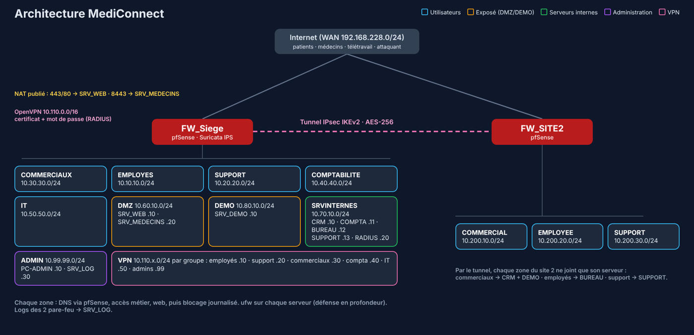

Deux pare-feu **pfSense 2.9.0** sont reliés par un tunnel **IPsec**. Au siège, chaque profil d'utilisateurs et chaque famille de serveurs a sa propre zone (un sous-réseau, une interface, ses règles), et pfSense est le **seul point de passage** entre les zones.

| Élément | Choix |
|---|---|
| Virtualisation | VMware Workstation, un réseau virtuel (VMnet) par zone, isolé de l'hôte |
| Pare-feu | 2 × pfSense CE (`FW_Siege`, `FW_SITE2`), Suricata sur FW_Siege |
| Serveurs | 9 × Ubuntu : web, médecins, CRM, comptabilité, bureautique, support, DEMO, RADIUS, logs |
| Postes | un par zone, au siège et au site 2, plus un poste de télétravail sur Internet |
| Attaquant | Kali Linux sur Internet |

<details>
<summary>📸 La maquette sous VMware et les interfaces de FW_Siege</summary>

| Machines virtuelles | Interfaces de FW_Siege |
|---|---|
| 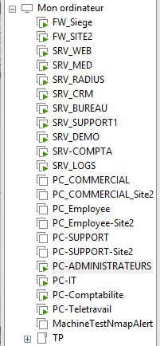 | 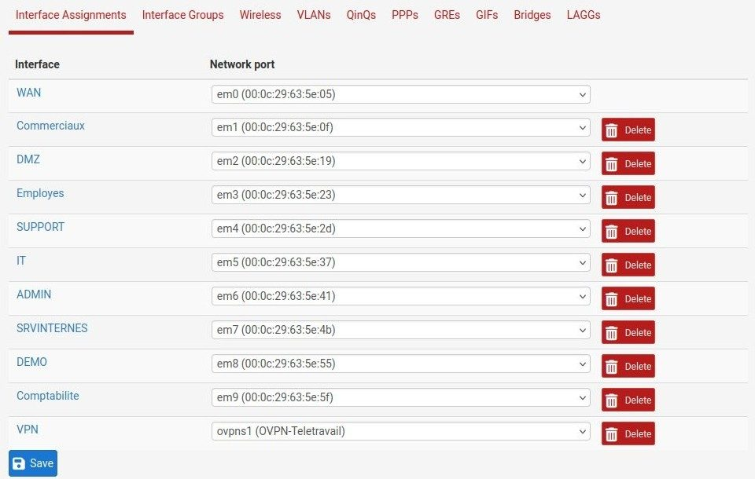 |

</details>

**Pourquoi pfSense ?** Il est open source et réunit dans une seule interface tout ce que demande le projet : filtrage, NAT, IPsec, OpenVPN avec RADIUS, Suricata et envoi des journaux.

---

## 2. Plan d'adressage

Chaque zone est un `/24` dédié, avec sa passerelle en `.1`. Les numéros de « VLAN » du guide sont repris dans le deuxième octet (10.**30**.30.0 = VLAN 30).

| Zone | Réseau | Confiance | Contenu |
|---|---|---|---|
| Internet | – | nulle | patients, médecins, nomades, attaquant |
| DMZ | 10.60.10.0/24 | faible | SRV_WEB (portail patients), SRV_MEDECINS |
| DEMO | 10.80.10.0/24 | faible | SRV_DEMO, données fictives |
| VPN | 10.110.0.0/16 | moyenne (identité vérifiée) | clients OpenVPN, une plage par groupe |
| EMPLOYES / SUPPORT / COMMERCIAUX / COMPTABILITE / IT | 10.10 à 10.50.x.0/24 | moyenne | postes de travail |
| SRVINTERNES | 10.70.10.0/24 | élevée | CRM, comptabilité, bureautique, support, RADIUS |
| ADMIN | 10.99.99.0/24 | maximale | poste d'administration, serveur de logs |
| Site 2 | 10.200.10/20/30.0/24 | moyenne | commerciaux, employés, support |

Les **alias** rendent les règles lisibles : un nom par serveur, par groupe VPN et par zone du site 2.

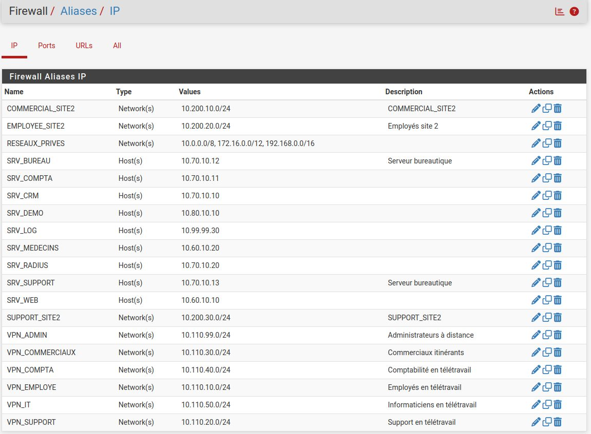

---

## 3. VPN et chiffrement

| | IPsec site à site | OpenVPN accès distant |
|---|---|---|
| Usage | relier le site 2 au siège | télétravail, commerciaux itinérants, admins à distance |
| Protocole | IKEv2 | SSL/TLS, UDP 1194, full tunnel |
| Authentification | clé pré-partagée | **certificat + mot de passe RADIUS (MFA)** |
| Chiffrement | AES-256, SHA-256, DH 14 | AES-256-GCM |

Le tunnel IPsec a **cinq phases 2, une par besoin** : chaque zone du site 2 ne peut joindre que son serveur métier, et le site 2 n'a aucune route vers les postes du siège.

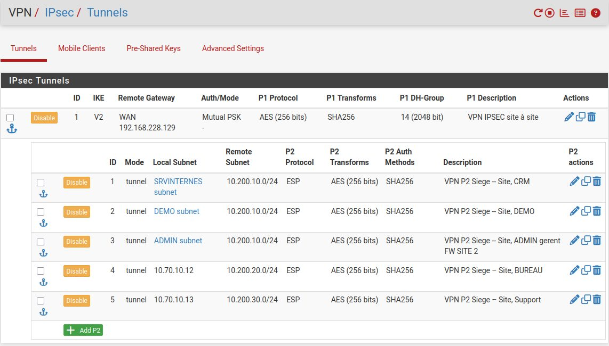

**Preuve du chiffrement.** Pendant qu'un poste consulte le CRM, une capture sur le WAN ne montre que des paquets **ESP** (IPsec) ou un flux **UDP 1194** illisible (OpenVPN).

| IPsec : uniquement de l'ESP | OpenVPN : contenu illisible |
|---|---|
| 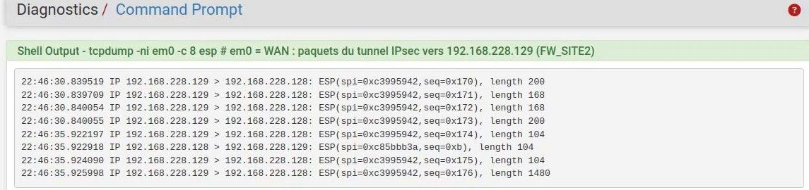 | 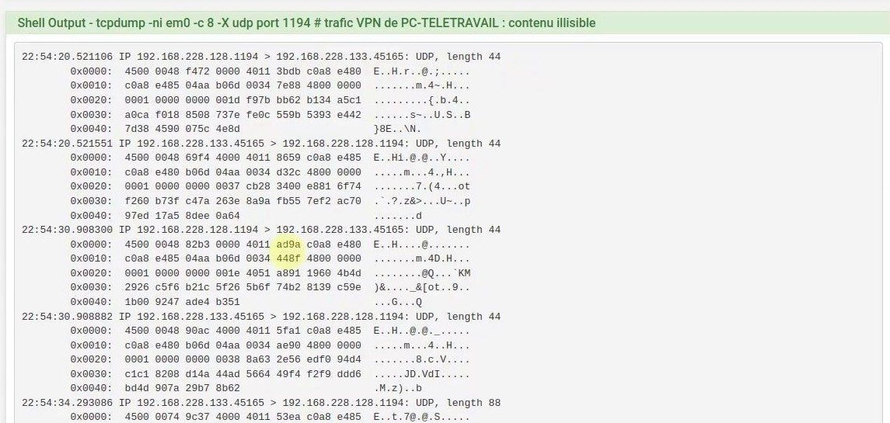 |

En **full tunnel**, tout le trafic du nomade passe par pfSense, y compris sa navigation, qui est donc filtrée et journalisée.

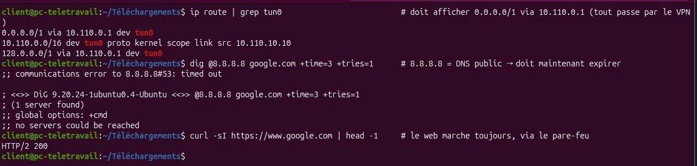

---

## 4. Authentification et MFA

FreeRADIUS vérifie le mot de passe et renvoie l'attribut **`Framed-IP-Address`**, c'est-à-dire une adresse dans la plage du groupe de l'utilisateur. *Strict User-CN Matching* impose que le certificat et l'identifiant appartiennent à la même personne.

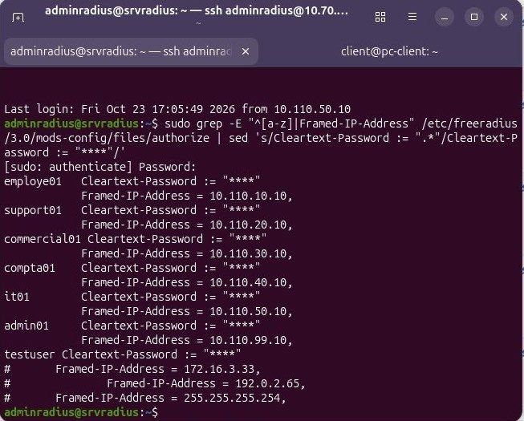

Un certificat d'un utilisateur avec le mot de passe d'un autre est refusé, tout comme un bon certificat avec un mauvais mot de passe : **un certificat volé ne suffit pas**.

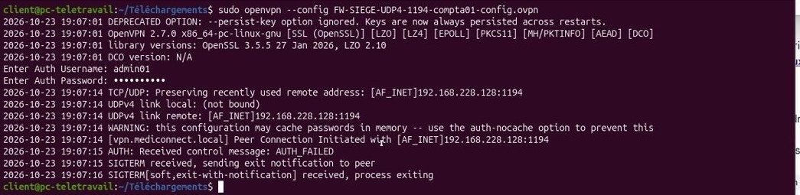

---

## 5. Politique de filtrage

Toutes les zones suivent le **même modèle**, évalué de haut en bas (la première règle qui correspond s'applique) :

1. DNS vers pfSense uniquement ;
2. le ou les serveurs du métier, par alias ;
3. Internet en web, vers `! RESEAUX_PRIVES` ;
4. ping de la passerelle ;
5. **refus par défaut, journalisé**.

| Zone COMMERCIAUX : CRM et DEMO | Zone EMPLOYES : SRV_BUREAU |
|---|---|
| 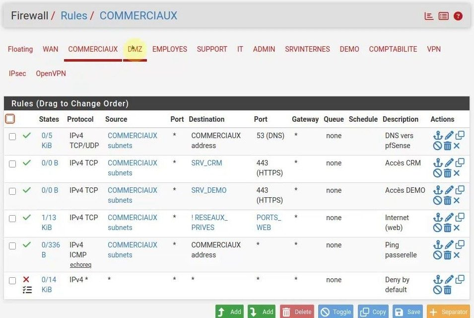 | 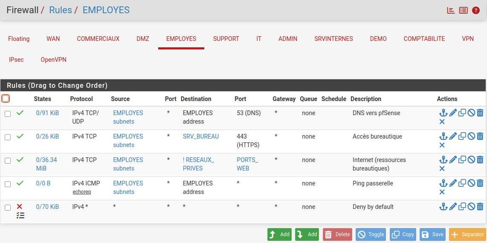 |

Matrice simplifiée des flux au siège (accès HTTPS) :

| Source | CRM | Compta | Bureau | Support | DEMO | SSH serveurs | pfSense |
|---|:-:|:-:|:-:|:-:|:-:|:-:|:-:|
| COMMERCIAUX | ✅ | ❌ | ❌ | ❌ | ✅ | ❌ | ❌ |
| COMPTABILITE | ❌ | ✅ | ❌ | ❌ | ❌ | ❌ | ❌ |
| EMPLOYES | ❌ | ❌ | ✅ | ❌ | ❌ | ❌ | ❌ |
| SUPPORT | ❌ | ❌ | ❌ | ✅ | ❌ | ❌ | ❌ |
| IT | ❌ | ❌ | ❌ | ❌ | ❌ | RADIUS seul | ❌ |
| ADMIN | ❌ (ufw) | ❌ (ufw) | ❌ (ufw) | ❌ (ufw) | ❌ (ufw) | ✅ tous | ✅ |
| DMZ, DEMO | ❌ | ❌ | ❌ | ❌ | ❌ | ❌ | ❌ |

---

## 6. Droits liés à l'identité

Les droits d'un utilisateur VPN dépendent de **qui il est, pas du poste qu'il utilise**. RADIUS lui attribue une adresse dans la plage de son groupe, et l'onglet VPN de pfSense filtre sur ces plages.

| Groupe | Plage | Accès |
|---|---|---|
| VPN_EMPLOYE | 10.110.10.0/24 | SRV_BUREAU |
| VPN_SUPPORT | 10.110.20.0/24 | SRV_SUPPORT |
| VPN_COMMERCIAUX | 10.110.30.0/24 | CRM, DEMO |
| VPN_COMPTA | 10.110.40.0/24 | serveur comptable |
| VPN_IT | 10.110.50.0/24 | SSH vers le RADIUS |
| VPN_ADMIN | 10.110.99.0/24 | SSH vers tous les serveurs, pare-feu |

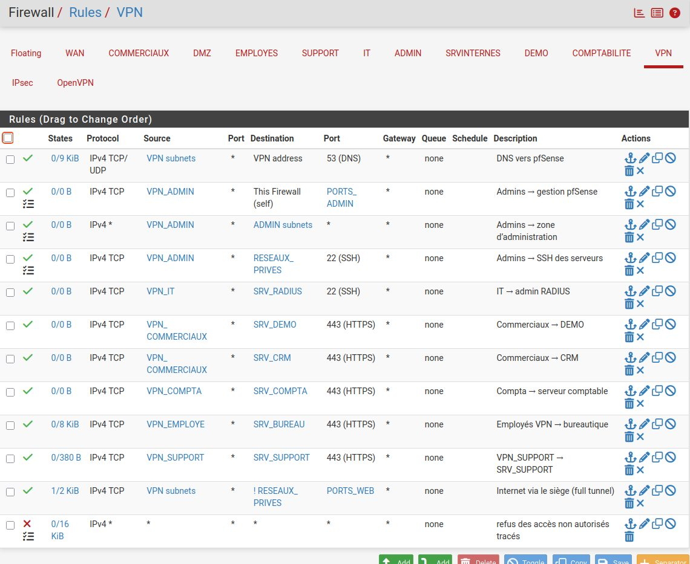

Le même PC de télétravail, connecté en `employe01`, n'accède qu'à l'espace bureautique :

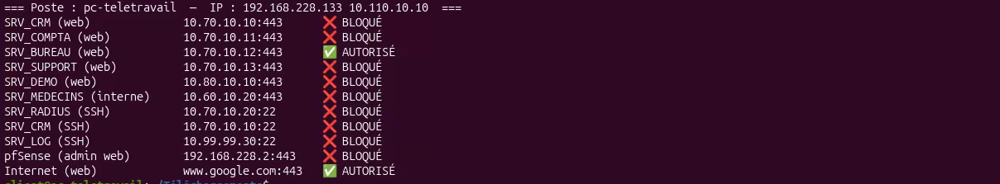

> L'onglet **OpenVPN** reste volontairement vide : pfSense l'évalue avant l'onglet VPN, donc une règle large à cet endroit contournerait tout le filtrage par identité.

---

## 7. Patients, médecins et DMZ

| Publication | Serveur | Accès |
|---|---|---|
| 443 | SRV_WEB | portail patients, ouvert à tous |
| 80 | SRV_WEB | redirection 301 vers HTTPS |
| 8443 | SRV_MEDECINS | espace médecins : **certificat client + mot de passe** |

| HTTP → HTTPS ; sans certificat : erreur 400 | Avec certificat et mot de passe : l'agenda |
|---|---|
| 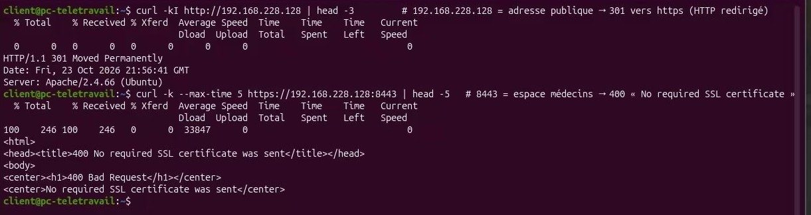 | 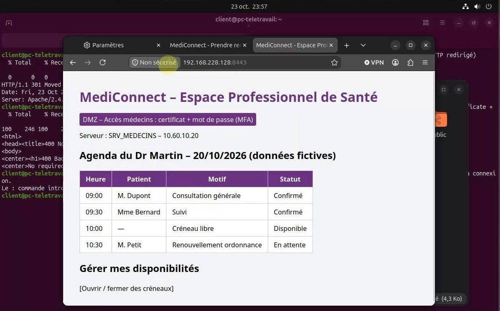 |

La **DMZ** et la **DEMO** ne peuvent **rien initier vers le réseau interne** : un serveur web compromis ne servirait pas de tremplin. La démonstration commerciale tourne sur une copie avec des données fictives, séparée de la production.

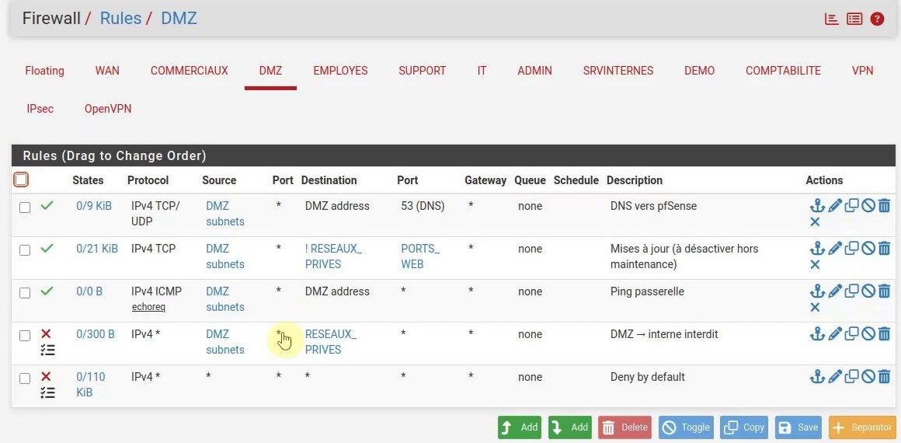

---

## 8. Administration sécurisée

- La règle **anti-lockout est désactivée** : le LAN n'est plus autorisé d'office à administrer pfSense.
- Les interfaces des pare-feu et le **SSH des serveurs** sont réservés à la zone **ADMIN** et au groupe **VPN_ADMIN** (avec MFA).
- Chaque serveur a un compte d'administration nommé et ses propres clés SSH.

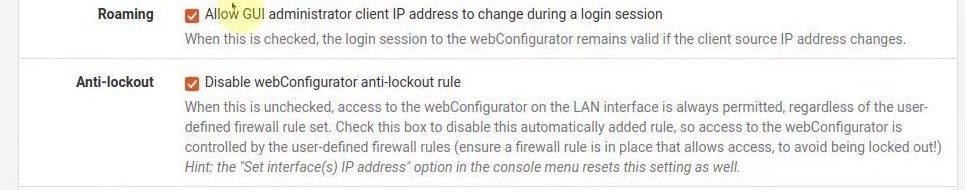

L'administrateur peut tout administrer en SSH, mais **n'utilise pas les applications métier** (moindre privilège) :

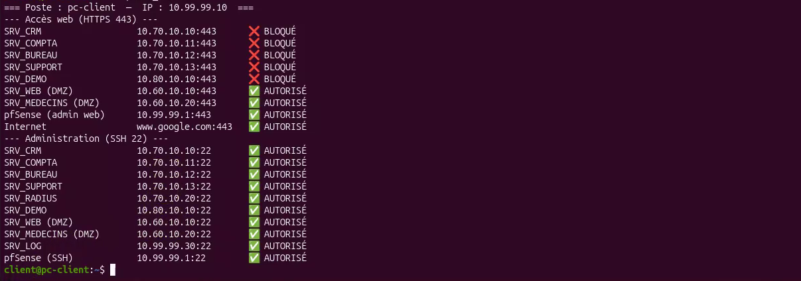

---

## 9. Défense en profondeur

Chaque serveur filtre aussi lui-même avec **ufw** : refus par défaut, seul son service, et seulement depuis les réseaux autorisés. Même si une règle pfSense devenait trop large, le serveur refuserait encore. Les serveurs d'une même zone ne peuvent pas se joindre entre eux.

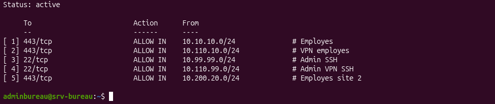

Exemple réel : pfSense laisse passer le poste d'administration, mais **SRV_COMPTA le refuse quand même** (ligne `UFW BLOCK`).

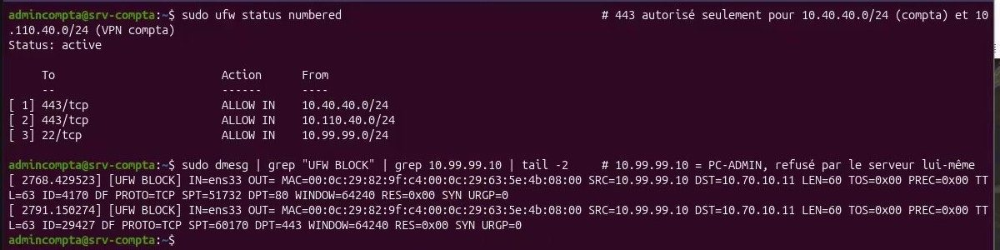

---

## 10. Détection d'intrusion et journaux

**Suricata** (signatures *Emerging Threats Open*) fonctionne en **IPS sur le WAN**, en blocage, et en **IDS sur la DMZ**, en détection. Lors d'un scan Nmap agressif depuis Kali, l'attaque est détectée et **l'adresse de l'attaquant est bloquée automatiquement**.

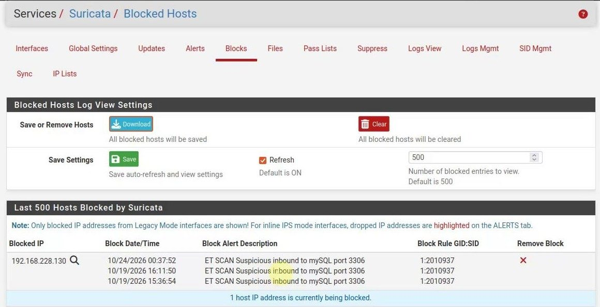

Les journaux des deux pare-feu (refus, IPsec, VPN, alertes Suricata) sont **centralisés en temps réel** sur `SRV_LOG` (rsyslog), dans la zone d'administration.

| Journaux reçus en direct | Alertes Suricata centralisées |
|---|---|
| 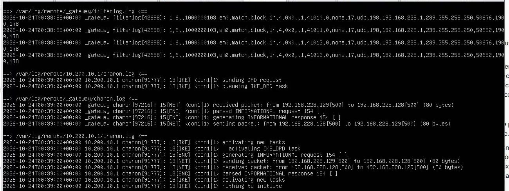 | 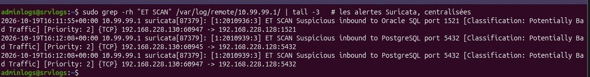 |

---

## 11. Tests

Chaque poste exécute [`test_acces.sh`](test_acces.sh), qui tente une connexion vers chaque serveur, en web (443) et en SSH (22) :

- ✅ **AUTORISÉ** : la connexion est établie ;
- ❌ **BLOQUÉ** : pas de réponse en 3 s, un pare-feu (pfSense ou ufw) a jeté le paquet.

```bash
chmod +x ~/test_acces.sh
~/test_acces.sh
```

| Poste commercial | Poste employé | Employé du site 2 (via IPsec) |
|---|---|---|
| 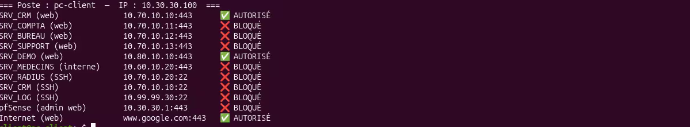 | 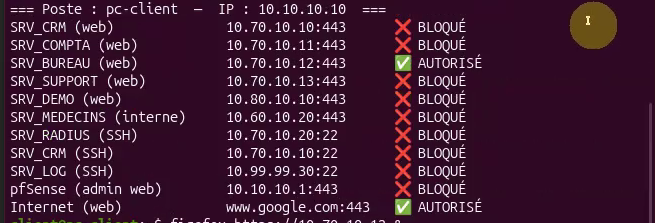 | 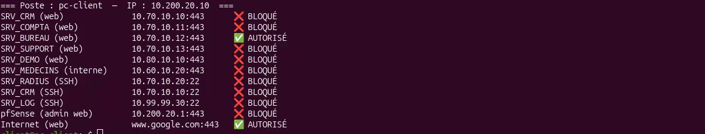 |

| Ressource ouverte depuis le bon poste | |
|---|---|
| 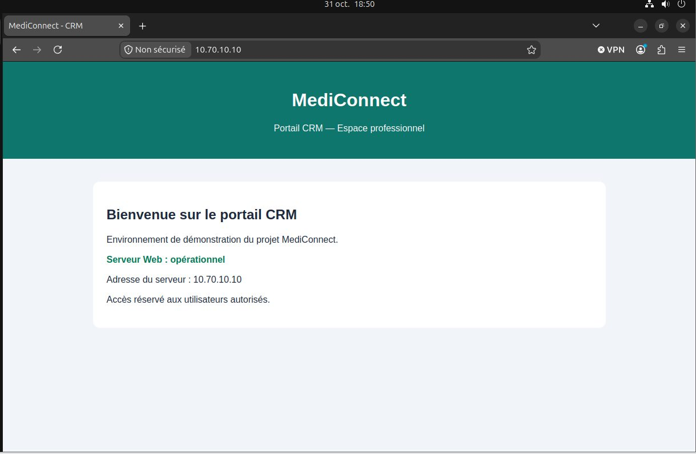 | 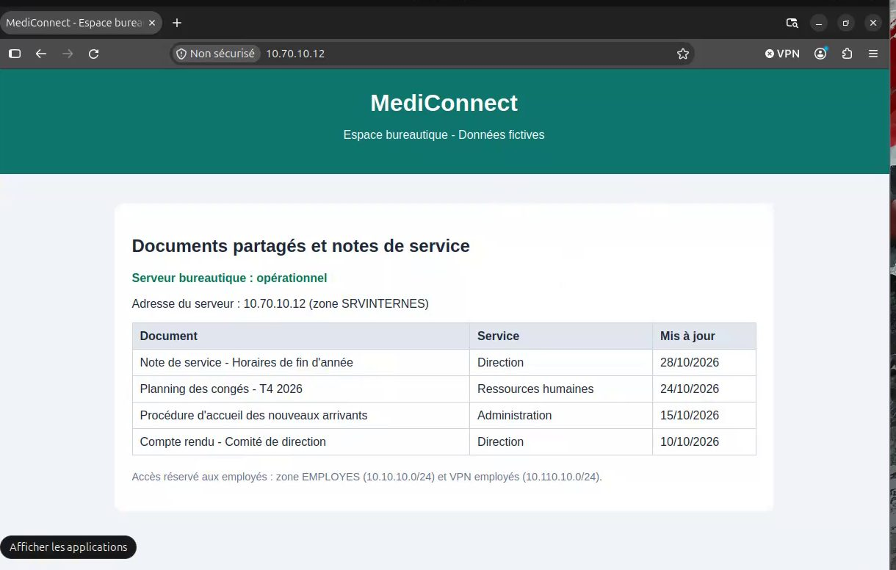 |

**Tous les tests sont conformes :**
- chaque profil ;
- chaque identité VPN ;
- le site 2 ;
- la DMZ et la DEMO ;
- l'administration ;
- l'attaque simulée.

Le tableau complet est dans la section 13 du rapport.

---

## 12. Limites et pistes d'amélioration

| Limite | En production |
|---|---|
| Réseaux virtuels VMware au lieu de VLAN 802.1Q | VLAN tagués sur un commutateur |
| 10 cartes réseau maximum par VM : cinq serveurs partagent SRVINTERNES (ufw compense) | une zone par application |
| IPsec par clé pré-partagée, certificats auto-signés | certificats IKEv2, autorité publique |
| Au siège, l'identité est déduite du poste et de sa zone | 802.1X ou portail captif avec RADIUS |
| Syslog en UDP, sans outil d'analyse | syslog TLS, SIEM (Wazuh, Graylog) |
| Pas de redondance des pare-feu | cluster CARP |

---

## Contenu du dépôt

```
├── README.md
├── Rapport_MediConnect_synthetique.pdf   # rapport (26 p. + annexes)
├── MediConnect_Overleaf.zip              # sources LaTeX (compiler avec XeLaTeX)
├── MediConnect_Demo.mp4                  # démonstration commentée (~17 min)
├── test_acces.sh                         # script de test des accès
└── images/                               # captures utilisées dans ce README
```

*Aucun secret (clé TLS, clé IPsec, secret RADIUS, mots de passe) n'est publié : les mots de passe sont masqués sur toutes les captures.*
